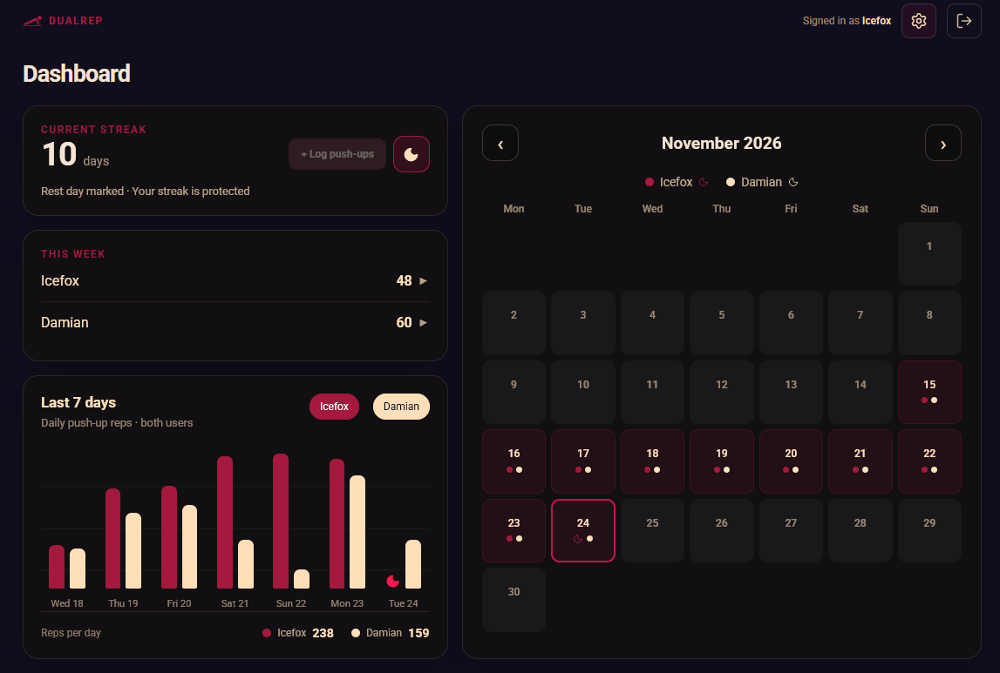

# DualRep

### Push together. Stay consistent.

**DualRep is a self-hosted push-up tracking Progressive Web App (PWA)
made specifically for two people: Icefox and Damian.**

Icefox and Damian share one dashboard to log push-up workouts, track
consistency, protect streaks with rest days, and motivate each other.
Each person has their own activity and progress, while both can see the
shared training journey.

## Features

-   **Built for two people** -- DualRep is designed around two users:
    **Icefox** and **Damian**.
-   **Individual activity tracking** -- Keep each person's workout
    history and progress separate.
-   **Push-up logging** -- Record sets and repetitions for supported
    push-up variations.
-   **Progress dashboard** -- View current streaks, weekly totals, and
    recent activity.
-   **Shared activity calendar** -- See Icefox's and Damian's workout
    activity in one monthly calendar.
-   **Manual rest days** -- Mark a rest day for either person. Rest days
    protect the streak without adding push-up repetitions.
-   **Weekly activity chart** -- Compare daily activity and distinguish
    rest days from workout days.
-   **Discord notifications** -- Optional reminders and partner activity
    notifications.
-   **Personal notification settings** -- Configure notification
    preferences for each person.
-   **Progressive Web App** -- Install DualRep on supported devices for
    an app-like experience.
-   **Self-hosted data** -- Store workout data in your own SQLite
    database.

## Screenshots

Add screenshots to `docs/screenshots/` and reference them here.

Example:



## Tech Stack

  Component       Technology
  --------------- ------------------------
  Frontend        React, TypeScript
  Build tool      Vite
  Styling         CSS
  Icons           Lucide React
  PWA             vite-plugin-pwa
  Backend         Node.js, Express
  Database        SQLite, better-sqlite3
  Notifications   Discord integration

## Project Structure

``` text
DualRep/
├── client/
│   ├── public/
│   ├── src/
│   │   ├── components/
│   │   ├── api.ts
│   │   ├── App.tsx
│   │   └── ...
│   ├── package.json
│   └── vite.config.ts
│
├── server/
│   ├── auth.js
│   ├── database.js
│   ├── index.js
│   └── package.json
│
└── .gitignore
```

## Getting Started

### Prerequisites

-   Node.js 24 (recommended)
-   npm
-   Git

### 1. Clone the repository

``` bash
git clone https://github.com/evilhny/DualRep.git
cd DualRep
```

### 2. Install backend dependencies

``` bash
cd server
npm install
```

### 3. Configure environment variables

Create a `.env` file inside the `server` directory.

``` env
# SQLite database location (optional)
DB_PATH=./dualrep.db

# Optional Discord integration
DISCORD_BOT_TOKEN=
DISCORD_ICEFOX_USER_ID=
DISCORD_DAMIAN_USER_ID=
```

If `DB_PATH` is not specified, the database defaults to
`server/dualrep.db`. For production deployments, an absolute database
path is recommended.

### 4. Start the backend

From the `server` directory:

``` bash
npm start
```

The backend listens on:

``` text
http://127.0.0.1:3001
```

### 5. Install frontend dependencies

Open a second terminal:

``` bash
cd DualRep/client
npm install
```

### 6. Start the frontend development server

``` bash
npm run dev
```

Vite starts the development server and proxies `/api` requests to the
backend on port `3001`. Open the local URL displayed by Vite.

## Production Build

Build the frontend:

``` bash
cd client
npm run build
```

The production build is generated in:

``` text
client/dist/
```

Start the backend from the server directory:

``` bash
cd server
npm start
```

For a public deployment, use a reverse proxy such as Nginx and configure
HTTPS.

## Database and Backups

DualRep uses SQLite through `better-sqlite3`. The database is created
automatically when the backend starts.

It stores application data such as:

-   User and session information
-   Workout sets and repetition counts
-   Manual rest-day records
-   Notification preferences

Back up the SQLite database regularly. Do not commit database files,
backups, credentials, or `.env` files to Git.

## Discord Integration

Discord integration is optional. When configured, DualRep can send
workout reminders and partner activity notifications.

Configure the Discord bot token and the Discord user IDs for **Icefox**
and **Damian** in `server/.env`. The core workout-tracking features do
not require Discord credentials.

## The Two Users

DualRep is intentionally designed for these two participants:

  User         Purpose
  ------------ -----------------------------------------------
  **Icefox**   Tracks personal push-up activity and progress
  **Damian**   Tracks personal push-up activity and progress

Both users share the same application and calendar, while their workout
records and progress remain associated with the correct person.

## Contributing

DualRep is a personal project. Suggestions, bug reports, and
improvements are welcome.

1.  Fork the repository.
2.  Create a feature branch.
3.  Make your changes.
4.  Test the frontend and backend.
5.  Submit a pull request.

## License

No license has been specified yet. Unless a license is added to this
repository, all rights are reserved.
